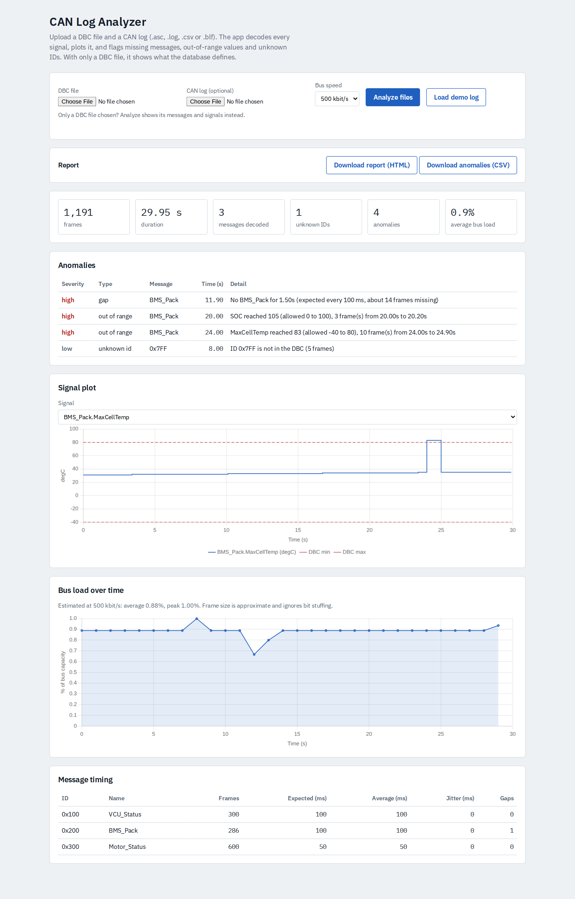
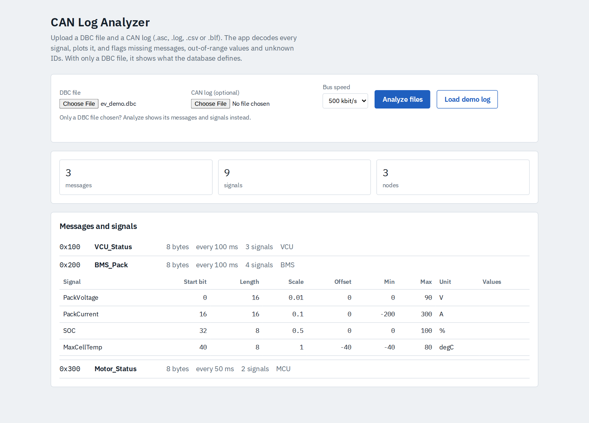

# CAN Log Analyzer

[](https://github.com/saivinayakmpawar/can-log-analyzer/actions/workflows/ci.yml)

[](LICENSE)

A web tool that decodes a CAN bus log against a DBC file, plots every signal, estimates bus load, and flags problems automatically. Upload two files and get a report you can attach to a bug ticket.



## Why

Debugging a CAN bus usually means scrolling through raw frames. This tool answers the first questions an engineer asks: Is every message arriving on time? Are any signals outside their defined range? Is anything on the bus that the database doesn't know about? How busy is the bus?

## Features

| Feature | What it does |
| --- | --- |
| Missing or late messages | Compares frame spacing with the DBC `GenMsgCycleTime` (or the median period when none is set). A gap over 3x the expected cycle is flagged with an estimate of frames lost. Messages that stop and never resume are caught too. |
| Out-of-range signals | Uses each signal's DBC min and max. Consecutive bad frames are merged into one event with the worst value. |
| Unknown IDs | Frames whose ID is not defined in the DBC. |
| Missing messages | Messages defined in the DBC that never appear in the log. |
| Decode errors | Frames that fail to decode, such as a DLC mismatch. |
| Timing statistics | Frame count, expected and average period, and jitter per message. Dropouts are excluded so the numbers describe normal operation. |
| Bus load over time | Estimated utilization per second at 125 kbit/s to 1 Mbit/s, with average and peak. Frame size is approximate and ignores bit stuffing. |
| Signal plots | Any decoded signal against time, with its DBC limits drawn as dashed lines. |
| Report export | Standalone HTML report with charts, and a CSV of the anomalies. |
| DBC-only mode | Upload just a DBC file to browse its messages and signals (start bit, length, scale, offset, range, unit, value names, cycle time). |

Supported log formats: `.asc` (Vector), `.log` (candump), `.csv` and `.blf`, through [python-can](https://python-can.readthedocs.io/).

## Quick start

```bash
github.com/saivinayakmpawar/can-log-analyzer.git.cd can-log-analyzer
python -m venv .venv
# Windows: .venv\Scripts\activate    macOS/Linux: source .venv/bin/activate
pip install -r requirements.txt
python -m uvicorn app.main:app --reload
```

Open http://127.0.0.1:8000 and click **Load demo log**.

### Docker

```bash
docker build -t can-log-analyzer .
docker run -p 8000:8000 can-log-analyzer
```

## Demo data

`app/sample/` holds a 30 s synthetic EV log (VCU, BMS and motor controller messages) with faults planted on purpose: a 1.4 s BMS dropout, an SOC spike to 105 %, a cell temperature of 83 degC, and frames with an ID missing from the DBC. All data is synthetic. Regenerate it with `python scripts/make_sample.py`.



## How it works

1. `python-can` reads the log frame by frame. Each frame is matched to a DBC message by its ID.
2. `cantools` decodes the signals. Values are checked against the DBC limits, and each message's arrival times are checked against its cycle time.
3. Frame sizes (47 bits plus 8 per data byte for standard IDs) are summed per second to estimate bus load.
4. The result is returned as JSON and drawn in the browser with Chart.js. Each plotted signal is downsampled to 1500 points.

## API

- `POST /api/analyze`: multipart upload with `dbc`, `log` and an optional `bitrate` field (125000, 250000, 500000 or 1000000). Returns the summary, anomalies, message timing, bus load and signal series.
- `POST /api/inspect`: multipart upload with only `dbc`. Returns the messages and signals it defines.
- `GET /api/sample`: analysis of the bundled demo.

Interactive API docs are at `/docs` when the server is running.

## Project layout

```
app/analyzer.py   decoding, anomaly detection, bus load, DBC inspection
app/main.py       FastAPI app and upload endpoints
app/static/       single-page UI (HTML and Chart.js)
app/sample/       synthetic demo DBC and log
scripts/          demo log generator
tests/            pytest suite
docs/             screenshots
Dockerfile        container image
```

## Tests

```bash
pip install -r requirements-dev.txt
python -m pytest
```

CI runs the suite on Python 3.10, 3.12 and 3.13 for every push.

## Limitations and ideas

- Uploads are capped at 25 MB.
- Bus load is an estimate and ignores bit stuffing and CAN FD.
- Planned: rolling-counter and checksum checks, multiplexed signals, J1939 support, click-to-zoom on anomalies, and live capture from a SocketCAN interface.

## A note on data

Don't commit real vehicle DBC or log files to a public repository. The `.gitignore` blocks `.dbc`, `.asc`, `.blf` and `.log` files except the synthetic demo files.

## License

MIT. See [LICENSE](LICENSE).
