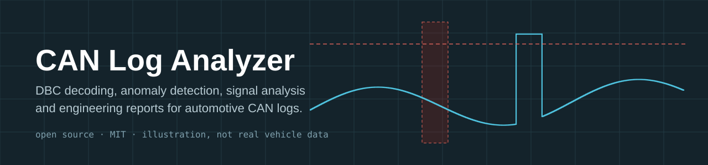
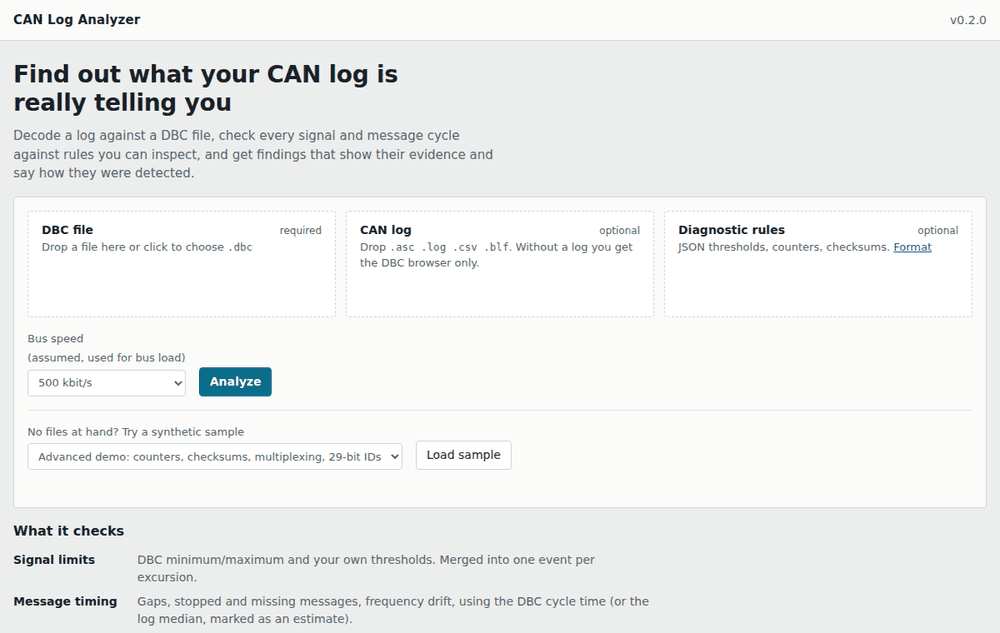
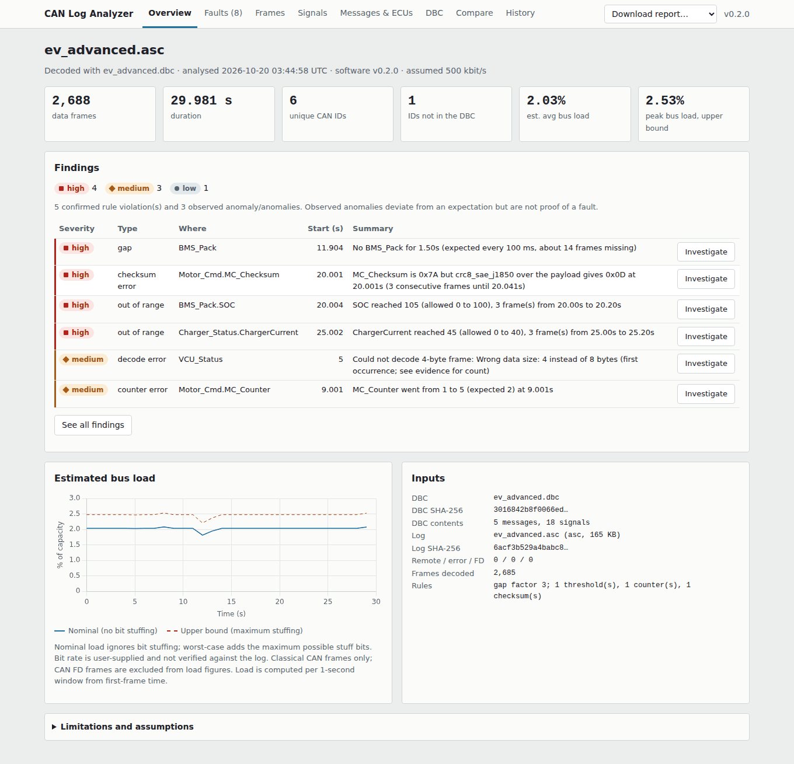
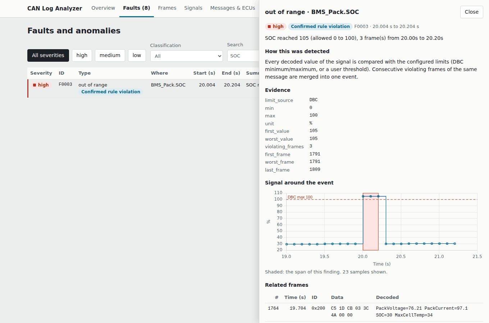
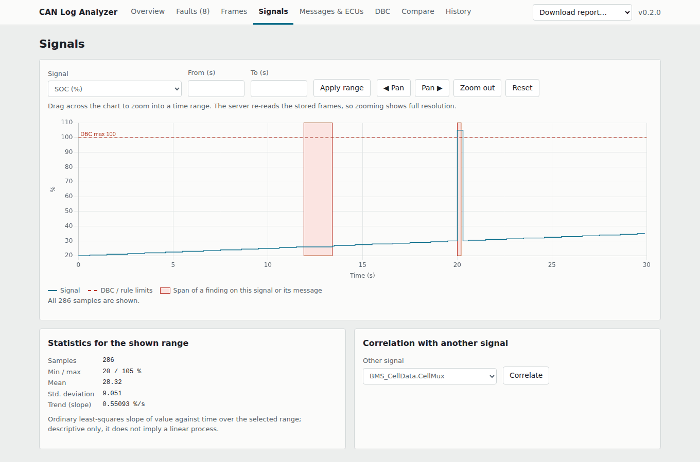
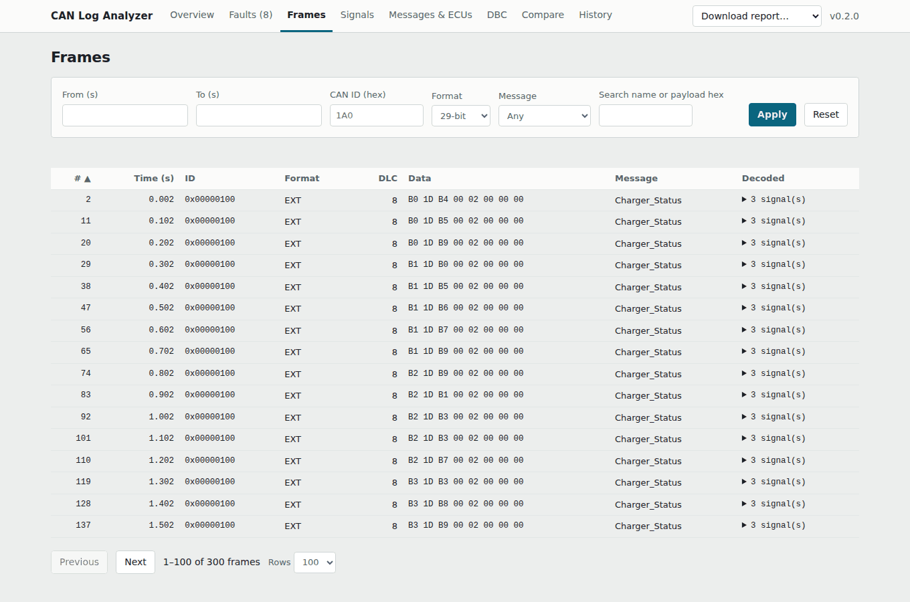

<p align="center"></p>

# CAN Log Analyzer

An open-source automotive CAN bus analysis and diagnostics platform featuring DBC decoding, signal visualization, anomaly detection, log comparison, and engineering reports.

[](https://github.com/saivinayakmpawar/can-log-analyzer/actions/workflows/ci.yml)
[](LICENSE)


Drop in a CAN log and the DBC that describes it. The analyzer decodes every frame, checks signals and message timing against the DBC and against rules you can read, and lists findings that **show their evidence and say how they were detected**. It reads log files; it does not talk to CAN hardware.



| Overview | Fault investigation |
|---|---|
|  |  |
| **Signal viewer** (drag to zoom) | **Frame viewer** |
|  |  |

All screenshots and the GIF were captured from this application running on the bundled synthetic samples.

## Quick start

```bash
git clone https://github.com/saivinayakmpawar/can-log-analyzer.git
cd can-log-analyzer
python -m venv .venv && source .venv/bin/activate      # Windows: .venv\Scripts\activate
pip install -r requirements.txt
python -m app
```

Open <http://127.0.0.1:8000> and pick **Load sample**. No files needed.

**Docker.** The Dockerfile was written without a Docker engine available, so it has not been built or run by the author of the upgrade. The `docker` job in `.github/workflows/ci.yml` builds it and checks the health endpoint on every push; treat Docker as unverified until that job is green.

```bash
docker compose up --build        # http://127.0.0.1:8000, analyses kept in a named volume
```

### Platforms

Developed and tested on Linux with Python 3.12. CI is configured for Python 3.10 to 3.13 on Ubuntu. The dependencies are pure Python or ship wheels for Windows and macOS, so those should work, but they have not been verified.

## What it checks

| Check | How it works | Reported as |
|---|---|---|
| **Signal limits** | Decoded values vs DBC min/max and your own thresholds. Consecutive violating frames merge into one event. A DBC range of `[0|0]` means "no limit". | confirmed rule violation |
| **Message timing** | Gap between frames vs the expected cycle: rules file, then DBC `GenMsgCycleTime`, then the median period in the log (marked as an estimate). Also stopped messages, messages missing from the log, and frequency drift. | observed anomaly |
| **Identifiers** | Frames are matched on *(ID, 11-bit/29-bit)*, so a standard `0x100` and an extended `0x100` are different messages. Unknown IDs and decode errors are listed. | observed anomaly |
| **Multiplexed signals** | Only the signals active for the received multiplexer value are decoded and checked. | n/a |
| **Rolling counters** | For counters you declare: every step must be +1 modulo the counter range. | confirmed rule violation |
| **Checksums** | For checksums you declare, with a built-in algorithm (`xor8`, `sum8`, `crc8`, `crc8_sae_j1850`) or your own plugin. | confirmed rule violation |
| **Log quality** | Timestamps that go backwards, lines the log parser skipped (`.asc`, `.log`), empty logs. | observed anomaly |
| **Bus load** | Estimated per second for classical CAN, with the assumptions written out (see below). | estimate |
| **Trend and correlation** | Least-squares slope per signal; Pearson correlation between two signals over a chosen range. | descriptive |
| **Log comparison** | Two analyses side by side: findings only in A / only in B, message timing and signal statistics deltas. | descriptive |

Findings never invent a cause. *Confirmed rule violation* means a rule you (or the DBC) defined was demonstrably broken. *Observed anomaly* means the data deviates from an expectation. Each finding lists its **evidence**, its **detection method**, and **possible causes** that are explicitly hypotheses.

### Example result

Analysing `app/sample/ev_advanced.asc` (synthetic, 2,688 frames, 30 s) with the bundled rules finds exactly the eight faults that were injected, and nothing in the clean twin log:

| ID | Severity | Class | Type | Where | t (s) |
|---|---|---|---|---|---|
| F0001 | high | observed | gap | BMS_Pack | 11.90 |
| F0002 | high | confirmed | checksum error | Motor_Cmd.MC_Checksum | 20.00 |
| F0003 | high | confirmed | out of range | BMS_Pack.SOC | 20.00 |
| F0004 | high | confirmed | out of range | Charger_Status.ChargerCurrent (29-bit) | 25.00 |
| F0005 | medium | observed | decode error | VCU_Status | 5.00 |
| F0006 | medium | confirmed | counter error | Motor_Cmd.MC_Counter | 9.00 |
| F0007 | medium | confirmed | out of range | BMS_CellData.CellV_A (user threshold) | 15.01 |
| F0008 | low | observed | unknown ID | 0x6A0 | 8.01 |

## Rules file

Optional JSON, uploaded next to the DBC. Unknown keys are rejected, and rules that name a message or signal that is not in the DBC fail with a clear message.

```json
{
  "gap_factor": 3.0,
  "frequency_tolerance_pct": 20,
  "thresholds": [{ "signal": "BMS_CellData.CellV_A", "min": 3.0, "max": 4.2, "severity": "medium" }],
  "messages": { "Charger_Status": { "tolerance_pct": 15 }, "BMS_Pack": { "cycle_ms": 100, "required": true } },
  "counters": [{ "message": "Motor_Cmd", "signal": "MC_Counter" }],
  "checksums": [{ "message": "Motor_Cmd", "signal": "MC_Checksum", "algorithm": "crc8_sae_j1850" }]
}
```

Counters and checksums are checked **only when declared**. The DBC format does not say which signal is a checksum or how it is computed, and this tool does not guess. Checksum signals must be byte-aligned 8-bit signals. See [`app/sample/ev_advanced.rules.json`](app/sample/ev_advanced.rules.json).

## Reports

From the dashboard or `GET /api/analyses/{id}/report.{html|pdf|csv}` (`?section=messages` for timing CSV).

A report contains the analysis date and software version, input file names, sizes and SHA-256 hashes, DBC information, the full rule configuration, traffic statistics, findings grouped by severity with evidence, method and hypotheses, message timing, signal plots with their limits, a bus-load plot, and the limitations. Reports are generated from the stored analysis (not the download time), so the same analysis always yields the same report. Estimated values are labelled as estimates.

## Bus-load assumptions

* Frame length uses the standard layout: 47 bits of overhead for 11-bit IDs, 67 for 29-bit IDs (both including interframe space), plus 8 bits per data byte.
* The headline figure ignores bit stuffing. An **upper bound** adds the maximum possible stuff bits.
* The bit rate is chosen by you; a log file does not contain it.
* CAN FD frames are decoded but **excluded** from load, because their length depends on a data-phase bit rate that logs do not record.

## Supported inputs and limitations

* Log formats: `.asc` (Vector), `.log` (candump), `.csv`, `.blf`, via python-can. Detecting lines the parser silently dropped works for `.asc` and `.log` only.
* DBC: classical CAN and CAN FD message definitions, multiplexing, value tables. Overlapping signals make the DBC load in tolerant mode, and a warning is shown.
* CAN FD: frames decode with the DBC definition; bit-rate switching is not evaluated. A payload longer than the DBC length is decoded with the DBC layout and the extra bytes are ignored.
* Cycle times for messages that have none in the DBC are estimated from the log, so gap detection for event-driven messages is only as good as that median.
* Message and ECU "status" summarises findings for this log. It is not a verdict on an ECU.
* Authentication is a single optional shared token. It is not a user system.
* No live capture and no hardware support.

## Configuration

All optional, via environment variables. Limits are enforced while the upload streams in, not after it has been read.

| Variable | Default | |
|---|---|---|
| `CAN_ANALYZER_DATA_DIR` | `./data` | Where analyses (decoded frames) are stored |
| `CAN_ANALYZER_MAX_LOG_MB` / `_MAX_DBC_MB` / `_MAX_RULES_KB` | 25 / 5 / 256 | Upload limits |
| `CAN_ANALYZER_MAX_FRAMES` | 3,000,000 | Frames per log |
| `CAN_ANALYZER_TIMEOUT_S` | 120 | Analysis time limit |
| `CAN_ANALYZER_MAX_CONCURRENT` | 2 | Parallel analyses (others get HTTP 503) |
| `CAN_ANALYZER_MAX_ANALYSES` | 25 | Newest analyses kept; older ones are deleted |
| `CAN_ANALYZER_TOKEN` | unset | If set, every API call needs `Authorization: Bearer <token>` |
| `HOST` / `PORT` | `127.0.0.1` / `8000` | For `python -m app` |

**Data handling.** Analyses are stored on the server's disk and contain decoded vehicle data. `data/` is git-ignored; delete an analysis from the History tab (or `DELETE /api/analyses/{id}`) to remove its frames. Do not expose the server to an untrusted network without TLS and `CAN_ANALYZER_TOKEN`. See [SECURITY.md](SECURITY.md).

**Performance.** One measurement on a development sandbox (Python 3.12, Linux): a 600,000-frame `.asc` log (38 MB) analysed at about 44,000 frames/s with a peak resident memory of 44 MB. Memory does not grow with log size because frames are streamed into SQLite. Your numbers will differ.

## API

Interactive docs at `/docs` while the server runs. Main endpoints:

| | |
|---|---|
| `POST /api/analyze` | multipart: `dbc`, `log`, optional `rules`, `bitrate`. Returns the full result plus `analysis_id`. Same shape as before, with additive fields. |
| `POST /api/inspect` | DBC only: messages and signals |
| `GET /api/sample?name=ev_demo\|ev_advanced\|ev_advanced_clean` | Analyse a bundled sample |
| `GET /api/analyses`, `GET/DELETE /api/analyses/{id}` | History |
| `GET /api/analyses/{id}/frames` | Paged, sortable, filterable frames |
| `GET /api/analyses/{id}/signal` | Signal series for a time range (min/max-preserving reduction) with statistics |
| `GET /api/analyses/{id}/correlation` | Correlation of two signals |
| `GET /api/analyses/{id}/findings/{fid}` | Finding plus the related frames |
| `GET /api/compare?a=&b=` | Compare two analyses |

## Project layout

```
app/
  analyzer.py     ingest, check loop, result assembly
  checks/         pluggable checks: ranges, timing, integrity, signals
  findings.py     finding model, methods, hypotheses
  rules.py        rules schema (pydantic)
  store.py        SQLite frame store
  history.py      on-disk analysis history
  queries.py      frame pages, signal ranges, correlation
  compare.py      log comparison
  reports.py      CSV / HTML / PDF
  main.py         API and security middleware
  static/         dashboard (Chart.js is vendored; nothing loads from a CDN)
  sample/         synthetic DBCs, logs and rules
scripts/          deterministic generators for the sample logs
tests/            pytest suite
docs/             architecture, screenshots
```

See [docs/ARCHITECTURE.md](docs/ARCHITECTURE.md) for the data flow and how to add a check.

## Development

```bash
pip install -r requirements-dev.txt
python -m pytest              # tests
ruff check app tests scripts  # lint
mypy                          # type check
pip-audit -r requirements.txt # dependency vulnerabilities
```

Regenerate the sample logs with `python scripts/make_sample.py` and `python scripts/make_advanced_sample.py`. All sample data is synthetic; do not commit real vehicle logs or proprietary DBC files.

Contributions are welcome: see [CONTRIBUTING.md](CONTRIBUTING.md).

## License

MIT. See [LICENSE](LICENSE).
