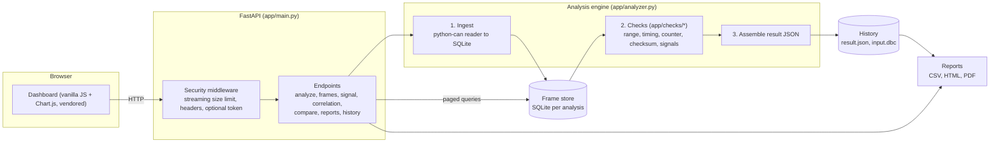

# Architecture



## Data flow

1. **Upload.** The security middleware counts request bytes as they arrive and rejects an oversized request before the multipart parser stores it. Each file is then copied to a temporary directory in 1 MB chunks under its own limit, using a fixed file name (the client's name is only displayed).
2. **Ingest.** `python-can` reads the log one frame at a time. Frames go into an SQLite table (`frames`), so Python memory stays flat regardless of log size. Bus-load counters are accumulated at the same time.
3. **Check.** The stored frames are streamed once, in order, through each registered `Check`. A frame is looked up by `(identifier, is_extended)`, so 11-bit and 29-bit IDs never collide.
4. **Assemble.** Findings are sorted by severity and time and given stable IDs (`F0001`, ...). The result, the DBC, and the frame store are kept in `data/<analysis-id>/`.
5. **Query.** The frame viewer, signal zoom and correlation read from SQLite on demand. Zooming re-decodes only the requested time range, so a zoomed view is exact even when the overview is reduced.

## Adding a check

A check is a class with two methods (see `app/checks/base.py`):

```python
from app.checks import Check, FinishContext, Frame
from app.findings import OBSERVED, Finding, FindingSink

class StuckSignalCheck(Check):
    name = "stuck"

    def on_frame(self, frame: Frame, sink: FindingSink) -> None:
        ...  # frame.values is None when decoding failed

    def finish(self, ctx: FinishContext, sink: FindingSink) -> None:
        ...  # emit findings that need the whole log; contribute ctx.sections[...]
```

Add it to `build_checks()` in `app/analyzer.py`, add a `METHODS` (and optionally `CAUSES`) entry in `app/findings.py` so the finding states how it was detected, and add tests. No other code changes are needed.

Custom checksum algorithms register through `app.checksums.register_checksum`.

## Finding model

Every finding carries:

| Field | Meaning |
|---|---|
| `classification` | `confirmed_violation`: a configured rule (DBC range, user threshold, counter or checksum definition) was broken. `observed_anomaly`: the data deviates from an expectation; not proof of a fault. |
| `evidence` | The measured values and frame indexes that triggered it. |
| `method` | How the check works, in plain language. |
| `possible_causes` | Hypotheses only. Never confirmed by the tool. |

## Resource limits

| Limit | Default | Variable |
|---|---|---|
| CAN log size | 25 MB | `CAN_ANALYZER_MAX_LOG_MB` |
| DBC size | 5 MB | `CAN_ANALYZER_MAX_DBC_MB` |
| Rules size | 256 KB | `CAN_ANALYZER_MAX_RULES_KB` |
| Frames per log | 3,000,000 | `CAN_ANALYZER_MAX_FRAMES` |
| Analysis time | 120 s | `CAN_ANALYZER_TIMEOUT_S` |
| Upload time | 60 s | `CAN_ANALYZER_UPLOAD_TIMEOUT_S` |
| Concurrent analyses | 2 | `CAN_ANALYZER_MAX_CONCURRENT` |
| Stored analyses | 25 | `CAN_ANALYZER_MAX_ANALYSES` |
| Findings per (type, signal) | 200 (the number dropped is reported) | fixed |

The frame and time limits are checked cooperatively inside the processing loops. A DBC that makes the parser itself run for a long time is bounded only by the DBC size limit.
